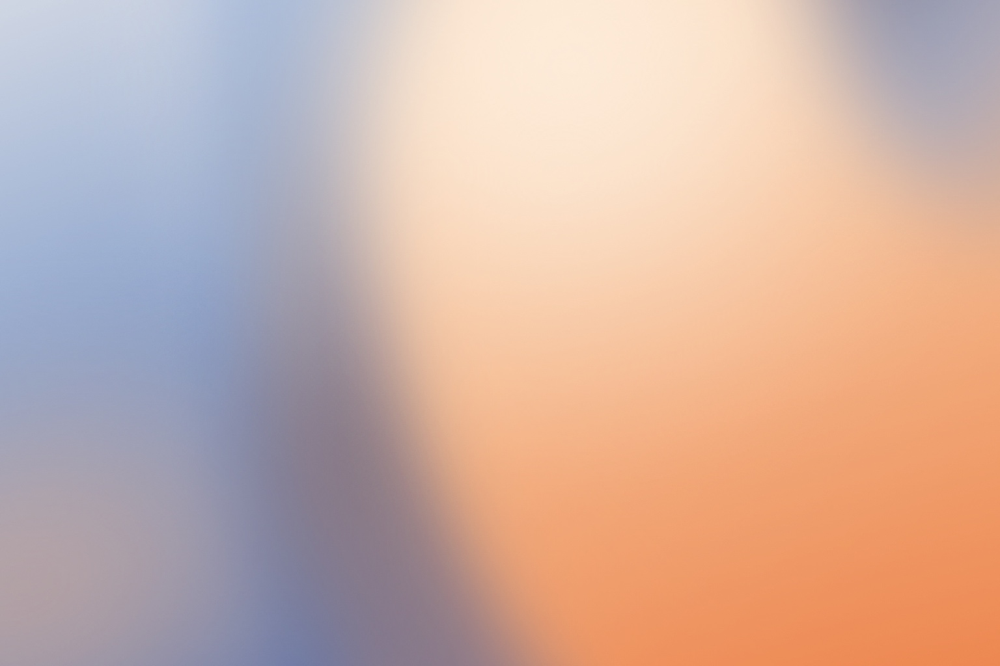
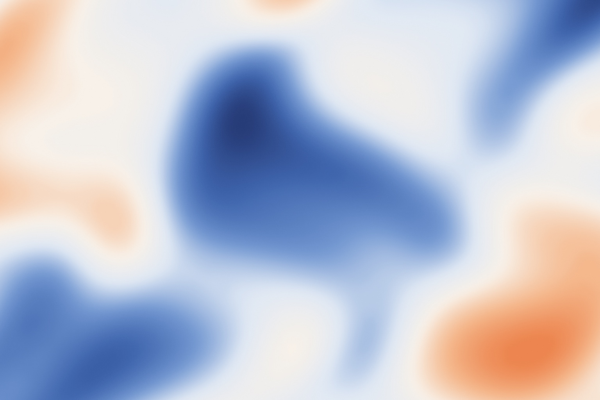

# Mesh Gradient Generation

A reusable agent skill for creating and refining mesh gradients for presentations,
websites and brand visuals. It combines art direction, palette selection and
editable Figma workflows, with SVG and code-rendering alternatives.

[English](#english) · [中文](#中文) · [For agents](AGENTS.md) · [Illustrated guide](index.html)

## Samples / 效果样例

Six newly designed native Figma studies, all **1536×1024 (3:2)**, using blue,
apricot/orange and warm white. Flower uses magnified cropped planes (56–85% opacity, 125–160 px blur); Heightmap now extracts 40 levels from a warped multi-peak field. Multipoint uses
eleven Gaussian-mask groups. The guide also compares the same Sky at
100/150/200 px blur. Images are flattened previews; the native builder and
recipes describe their editable construction.

六张均已重新在 Figma 绘制，统一为 **1536×1024（3:2）**，蓝色搭配杏橙和暖白。
本轮重画 Sky 的宽色流、Dreamlike 的错位透光和 Flower 的花瓣局部。Flower 的四个瓣面不透明度为 56–85%，模糊 125–160 px；Heightmap 从多峰高度场提取 40 级等高区域。Multipoint 用十一组宽窄不同的色团形成流向。
图解里另有同一张 Sky 的 100／150／200 px 对照。图片是预览，重建源码和配方
说明如何保留可编辑图层。

| Sky-inspired | Dreamlike |
|---|---|
|  |  |
| Flower-inspired | Diffuse |
|  |  |
| Heightmap | Multipoint |
|  |  |

### How the samples are made / 样例如何制作

| Sample / 效果 | Native construction / 原生做法 | At 1536×1024 / 本图参数 |
|---|---|---|
| Sky-inspired | Broad diagonal current; 3 curved planes + 2 light fields / 宽幅斜向色流，三条曲线与两个光场 | 125–155 px blur |
| Dreamlike | Unequal offset light and shadow; 2 planes + 4 fields / 两个曲面与四个光场，错位安排亮部、阴影和透光区 | 120–165 px blur |
| Flower-inspired | Magnified cropped petals; 4 translucent planes + 2 reflections / 放大的花瓣局部，四个半透明瓣面与两处反光 | Plane opacity / 瓣面不透明度 56–85%; blur 125–160 px |
| Diffuse | 1 curve + 3 broad radial fields / 一条曲线与三个宽幅径向色场，降低局部对比 | 155–185 px blur |
| Heightmap | Warped field with peaks, valleys and saddles; marching-squares contour extraction / 弯曲高度场叠加峰谷与鞍部，再提取等高区域 | 40 levels / 40 级; blur 24–38 px |
| Multipoint | 11 Gaussian alpha-mask groups with separate color fills / 十一组高斯透明度遮罩，各有独立颜色层 | No extra blur / 额外 blur 为 0 |

[Full recipes and controls / 完整配方与参数](references/figma-recipes.md) ·
[Rebuild these six studies / 重建六张样例](scripts/blue_orange_studies.js) ·
[Required native helper / 所需原生辅助函数](scripts/figma_native.js).
The builder requires a connected Figma execution tool. Heightmap exposes
`detail`, `warp`, `levels`, `blurMin` and `blurMax`; the recipe explains valid ranges.
构建函数需要在已连接的 Figma 执行工具中运行。Heightmap 可分别调整次级起伏、
坐标弯曲、等高层数和模糊值；有效范围与调用示例见配方。

Four browser palette studies share one composition; these are separate from
the native studies above. Exact colors, layer order and fade stops are in
[palette/layout recipes](references/palettes-and-layout.md).
四张浏览器配色示例使用相同构图；具体颜色、叠层和渐隐参数见配方。

| Monochromatic / 单色层次 | Analogous / 邻近暖色 |
|---|---|
|  |  |
| Apricot/cobalt / 杏橙钴蓝 | Neutral/accent / 冷中性强调 |
|  |  |

## English

### For people

#### Purpose and practical value

Use this skill when a gradient needs to support a real design task: a presentation
cover, a readable content-slide background, a website hero, a project thumbnail,
or a consistent family of brand/campaign visuals.

It helps turn a reference or an open-ended request into decisions an agent can
execute: which colors play which roles, where the main masses sit, where text
needs space, how edges merge, and what the user should be able to edit later.
The intended value is less repeated setup and more consistent revisions; no
measured productivity or business-outcome claim is made.

| Application | What the skill helps decide |
|---|---|
| Presentations / PPT | Slide ratio, title-safe space, restrained content backgrounds and export size |
| Websites and thumbnails | Desktop/mobile crops, text protection, visual hierarchy and small-size readability |
| Brand and campaign systems | Palette roles, recognizable shape grammar and controlled variations across assets |
| Reference reconstruction | Native editable color masses, optional separately labeled raster detail, and comparison with the target |

#### How to use it

1. Install the complete folder as `mesh-gradient-generation` in your agent's
   skills directory. Keep the complete folder, including `references/`,
   `scripts/` and `design/` sample assets.
2. Provide the intended use, dimensions/aspect ratio, a reference or brand colors,
   the area reserved for content, and the required editability/output format.
   If you have not chosen colors, ask for a few palette directions at the same
   composition before making a larger set.
3. For native Figma output, connect a tool that can write to the canvas and give
   the agent the target file. This skill does not supply a connector or sign in
   to Figma. The agent must discover the connection's actual capabilities.
4. Review the artwork in its intended application. Refine palette, distribution,
   fusion and contrast; preserve the selected composition during color comparison.

For Codex, a typical installation is:

```sh
git clone https://github.com/9929y/mesh-gradient-generation.git \
  ~/.codex/skills/mesh-gradient-generation
```

Reload your client's skill list if needed. Other agents have their own loading
conventions. Installing the files does not itself enable automatic invocation
in every client.

Example request:

> Use $mesh-gradient-generation to create a 16:9 presentation-cover gradient.
> Compare monochromatic, analogous and restrained contrasting palettes using
> the same composition. Keep the left third quiet for a dark title. After I
> choose a direction, build editable layers in my Figma file, inspect the result,
> and explain how to change its colors and softness.

### For agents

#### Read order and execution

Working in the repository: read [AGENTS.md](AGENTS.md), then
[SKILL.md](SKILL.md). Invoked through a skill loader: the client normally loads
`SKILL.md` directly. `AGENTS.md` is a repository reading/maintenance guide;
it does not replace the skill or connect to Figma. Read only what the task needs:

| Task | Read next |
|---|---|
| Choose use case, palette, brand direction or simple editing controls | [Art direction](references/art-direction.md) |
| Reuse sample colors, adapt aspect ratio or tune 100–200 px blur | [Palette and layout recipes](references/palettes-and-layout.md) |
| Build Sky-inspired, Dreamlike, Flower-inspired, Diffuse, Heightmap or Multipoint artwork; reconstruct a reference | [Figma recipes](references/figma-recipes.md) |
| Operate Figma, export SVG, or choose another rendering tool | [Tool adapters](references/adapters.md), plus the installed connector's current instructions |
| Explore fluid, pigment, oil/brush or chromatic silhouette rendering | [Related effect recipes](references/effects.md) |
| Add ambient motion or source-image reveal | [Motion guidance](references/motion.md) |

Inspect the target tool and existing artwork before making changes. Use the
helper that fits the task; do not execute every script or load every reference
by default. Return the artifact/node link, editable controls, validation evidence
and relevant limitations. Repository instructions do not replace the user's
choices or provide permission to modify an unrelated file.

#### Included tools and boundaries

- `scripts/figma_native.js`: `buildMesh(figma, spec)` creates isolated native
  Gaussian-mask groups with separate color fills and returns their node IDs.
  Inline it into a supported Figma execution tool; it is not a standalone plugin.
- `scripts/render_svg.py`: Python 3 standard-library generator for four original
  schematic studies. For example:

  ```sh
  python3 scripts/render_svg.py --effect atmospheric --seed 17 \
    --width 1200 --height 800 --output study.svg
  ```

- `scripts/blue_orange_studies.js`: rebuilds the six current native studies
  after `figma_native.js` is inlined. Uses caller-supplied clear x/y; has been
  executed and visually inspected in live Figma. The compositions use 3:2. Optional `keys` selects individual studies; `heightmap` controls detail, warp, levels and blur.
- `scripts/palette_studies.js`: four role-based palette previews and three
  size-aware layout recipes. `layoutSpec` converts short-side support radii to
  the native helper's per-axis units. New layout parity with live Figma is unverified.
- `index.html`: the single illustrated Chinese guide with real Figma samples,
  a Sky 100/150/200 px blur comparison, four visible palette examples and recomposed
  16:9 / 1:1 / 9:16 studies. Download the **whole repository** and open this file
  locally; it uses local images/scripts. GitHub's file view displays HTML source.
  The comparison does not sync edits to Figma.

The six recipes include a native builder for the current blue/orange studies;
this is a function library for a supported execution tool, not a standalone plugin. The package does not include image segmentation, a shader/reveal engine
or automatic PPT creation. Native geometry, imported SVG and flattened bitmaps
have different editing limits. For broad light fields, compare 100/150/200 px at a 1536×1024 reference scale.
The current Flower planes use 125–160 px blur and 56–85% opacity. Heightmap uses 40 extracted levels with 24–38 px blur and exposes detail/warp/level controls. Scale
the selected radius by the short side when resizing the canvas.
Recompose for a new aspect ratio. Mask-based masses have no extra blur by default.
The legacy SVG `petal` sketch is not a visual target for Flower-inspired artwork.

Recipes are grounded in inspected native artwork and recovered historical
construction records. The six-study builder and its Gaussian-mask helper have now been executed
in live Figma and their actual renders inspected. Browser layout specs still
need live-target calibration. Validation details are in the guide.

## 中文

### 给使用者

#### 用途与价值

当你需要给一份 PPT 做封面、给网页留出清楚的标题区域，或者让一组品牌视觉
保持一致时，难点往往不只是“生成一个好看的渐变”。你还需要决定颜色怎么搭、
色块放在哪里、哪些地方应该留白，以及之后怎样方便地修改。

**Mesh Gradient Generation** 把这些判断整理成 Agent 可以执行的流程：先确定
用途和视觉方向，再选择配色与构图，连接 Figma 或其他合适的工具制作，最后
检查实际效果和可编辑范围。目标是减少重复设置、让修改更一致；目前没有对节省
时间或商业效果做量化验证。

| 使用场景 | 重点解决什么 |
|---|---|
| PPT 封面、章节页、内容页 | 按原幻灯片比例设计，给标题和图表让出空间，选择合适的导出尺寸 |
| 网页主视觉、项目缩略图 | 检查桌面和手机裁切、文字可读性，以及缩小后是否仍有层次 |
| 品牌和活动视觉 | 固定颜色角色与形状语言，在多个应用中做有控制的变化 |
| 参考图复现 | 分开可编辑色场与可选的位图细节，并用实际导出结果核对差异 |

#### 安装与使用

1. 将整个目录安装为 `mesh-gradient-generation`，保留内部结构。Codex 常用位置
   是 `~/.codex/skills/mesh-gradient-generation/`；安装命令见上面的英文部分。
   其他 Agent 按各自的 Skill 加载方式使用。
2. 告诉 Agent：用在哪里、画面比例或尺寸、参考图或品牌色、哪里放文字，以及
   是否需要可编辑图层。没选好颜色时，可以先比较单色、邻近色、克制撞色等方向。
3. 需要直接在 Figma 制作时，先接通支持画布写入的工具，并提供目标文件。
   MCP 在这里负责让 Agent 读取和操作 Figma；安装这份 Skill 本身不会建立连接，
   也不会自动登录账号。
4. 将结果放回真实页面或幻灯片里看，再调整配色、分布、融合和对比。比较颜色时
   保持构图不变，避免同时改变太多因素。

可以直接这样提需求：

> 使用 $mesh-gradient-generation，为 16:9 的演示文稿制作封面渐变。
> 在同一个构图上比较单色、邻近色和克制撞色三种配色，左侧三分之一留给深色标题。
> 等我选定方向后，在我提供的 Figma 文件里建立可编辑图层，回看实际效果，
> 并说明我以后如何改色和调整柔和程度。

### 给 Agent

#### 阅读顺序与执行

直接在仓库里工作的 Agent：先读 [AGENTS.md](AGENTS.md)，再读
[SKILL.md](SKILL.md)。通过 Skill 加载器调用时，通常直接加载 `SKILL.md`。
AGENTS.md 负责说明仓库怎么读、怎么维护；SKILL.md 负责执行制作流程。
这两个文件都不会自动连接 Figma。随后按当前任务读取参考：

| 当前要做什么 | 读取什么 |
|---|---|
| 判断用途、选择配色、考虑品牌审美和修改方式 | [art-direction.md](references/art-direction.md) |
| 复用配色样例、调整画幅、选择模糊值 | [palettes-and-layout.md](references/palettes-and-layout.md) |
| 制作六类 Figma 效果，或复现已有参考 | [figma-recipes.md](references/figma-recipes.md) |
| 操作 Figma、导出 SVG、选择其他工具 | [adapters.md](references/adapters.md)，以及当前连接工具的说明 |
| 研究流体、颜料、油彩笔触、彩色剪影等相关方向 | [effects.md](references/effects.md) |
| 增加缓慢运动或图片显影 | [motion.md](references/motion.md) |

先检查工具能力和目标文件里已有的内容，再动手制作。只读需要的参考、只运行
当前任务用得上的脚本。交付时说明产物位置、可调参数、检查结果和实现限制。
不要因为读到了仓库文件，就推定可以修改用户未指定的其他项目。

#### 已提供什么，还有哪些边界

原生 Figma 函数会建立“独立色团组＋高斯柔化遮罩＋纯色 Fill”，并返回各层的
节点 ID，便于后续定点改色和调整构图。它需要在支持的 Figma 执行工具中调用，
不是双击就能运行的插件。

SVG 脚本使用 Python 3 标准库生成四类原创示意；新增蓝橙六图原生构建函数，
可在支持的 Figma 执行工具中按指定位置重建。它是函数库，不是独立插件。Heightmap 已包含等高线提取，参数说明见配方。本包未实现自动做 PPT、图片分割或完整
动画引擎。原生图层、导入 SVG 和位图的可编辑程度不同，需要分别说明。

图解都在同一份 [index.html](index.html) 中：六类实际 Figma 样例、Sky 三档原生模糊
对照、四张配色示例和比较器，以及 16:9、1:1、9:16 的重排演示。请下载整个
仓库再打开本页，保留图片和脚本目录；GitHub 文件页只显示 HTML 源码。
页面里的修改不会自动同步到 Figma。

宽幅光场可比较 100、150、200 px；本轮 Flower 的瓣面使用 125–160 px 模糊和 56–85% 不透明度；
Heightmap 有 40 级等高区域，使用 24–38 px 模糊，并开放起伏、扭曲和层数参数。按短边换算具体值；换比例时重新安排色团和留白。多点遮罩默认不额外模糊。新 `palette_studies.js` 提供
可复用配色与画幅参数；其中布局参数尚未与实时 Figma 渲染校准。旧 SVG 的
`petal` 草图不作为 Flower 效果的视觉参考。

制作方法已结合原生作品结构和恢复的历史操作记录核对。本轮六图构建函数和高斯遮罩函数已在
真实 Figma 中执行并检查了渲染；浏览器画幅参数仍需目标工具校准。验证状态见图解。

## License / 许可

[MIT](LICENSE). Independent community project; not affiliated with Figma or an
image-generation provider. 独立社区项目，与 Figma 或图像生成服务商无隶属关系。
